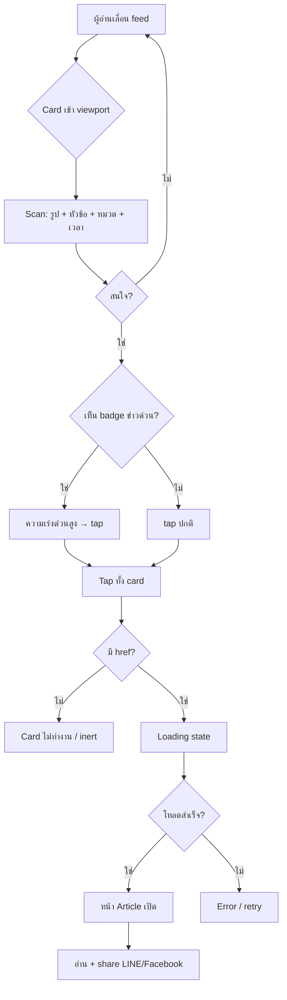

# User Flow ArticleCard (Feed → อ่านบทความ)

> Component: `components/ArticleCard` Platform: Mobile (70%+ ของ traffic) Audience: ผู้อ่านข่าวไทย 25–55 ปี

## Context

ผู้อ่านเลื่อน feed บน mobile แล้ว scan headline เร็วๆ เพื่อตัดสินใจว่าจะกดเข้าอ่านหรือไม่
ArticleCard คือจุดตัดสินใจหลัก ภายในไม่กี่วินาทีต้องสื่อสาร หัวข้อ + หมวด + ความสด (เวลา/ข่าวด่วน) ให้ครบ
target การกดทั้ง card ต้องเป็น tap target เดียว (ทั้งใบนำไป `href`) เพราะใช้นิ้วโป้งบนจอเล็ก

## Flow Diagram

## Edge Cases

1. **ไม่มี `imageUrl`** card ต้องไม่พังเลย์เอาต์ ใช้ placeholder/aspect-ratio reserved กัน layout shift (CLS) ตอนรูปโหลดช้าบนเน็ตมือถือ
2. **หัวข้อยาวมาก** headline ภาษาไทยไม่มีเว้นวรรคคำ ต้อง clamp จำนวนบรรทัด (เช่น 2–3 บรรทัด) ไม่ให้ card สูงไม่เท่ากันจน feed เสียจังหวะ
3. **ไม่มี `href`** card ต้องไม่ดูเหมือนกดได้ (ไม่มี hover/active affordance, ไม่เป็น link) ป้องกัน dead tap

## Design Implications (ArticleCard)

- **Tap target ทั้งใบ**: ทั้ง card คือ link เดียวไป `href` พื้นที่กด ≥ 44px ตามนิ้วโป้ง ไม่แยกปุ่มย่อยที่แข่งกับ main action
- **Visual hierarchy เพื่อ scan เร็ว**: `title` เด่นสุด, `category` + `publishedAt` เป็น metadata รอง, `isBreaking` badge ต้องชัด/contrast สูงเพราะเป็นตัวเร่งการตัดสินใจ
- **กัน layout shift**: reserve พื้นที่รูปด้วย aspect-ratio + clamp บรรทัด `title`/`excerpt` ให้ความสูง card คาดเดาได้ ป้องกัน CLS บน mobile feed
- **`site` accent ต้องคงอ่านง่าย**: สี accent ต่อเว็บในเครือ (bangkokbiznews/komchadluek ฯลฯ) ใช้เน้น category ได้ แต่ contrast ของ title ต้องไม่ลดลง
